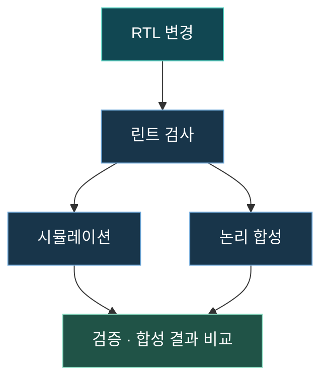

<h1 align="center">디지털 칩 설계 자동화</h1>

<strong>RTL 설계 · 회귀 검증 · 타이밍 분석</strong>

<code>SystemVerilog</code> &nbsp; <code>Python</code> &nbsp; <code>GitHub Actions</code>

---

## 회로를 바꿀 때마다 무엇을 확인할까?

작은 디지털 회로부터 설계하고, RTL을 수정할 때 기능과 합성 결과가 어떻게 달라지는지 추적합니다. 같은 입력과 제약으로 실험을 반복할 수 있도록 테스트 조건과 도구 버전을 기록하는 데 관심이 있습니다.

## 자동화 워크플로 구상

## 실험 주제

- **UART 송수신기** · 시작 비트, 정지 비트, 전송 속도 설정을 바꿔가며 수신 파형을 확인합니다.
- **파이프라인 곱셈기** · 레지스터를 추가했을 때 지연 사이클과 임계 경로가 어떻게 달라지는지 비교합니다.
- **합성 리포트 비교** · 동일한 셀 라이브러리와 클록 제약에서 셀 면적과 타이밍 여유를 기록합니다.

> 비교할 때는 테스트 입력과 합성 조건을 고정하고, 변경 전후의 리포트를 함께 남깁니다.

## 도구 문서

[Verilator](https://verilator.org/) · [Yosys](https://yosyshq.readthedocs.io/projects/yosys/en/latest/) · [OpenROAD Flow](https://openroad-flow-scripts.readthedocs.io/en/latest/user/UserGuide.html)
