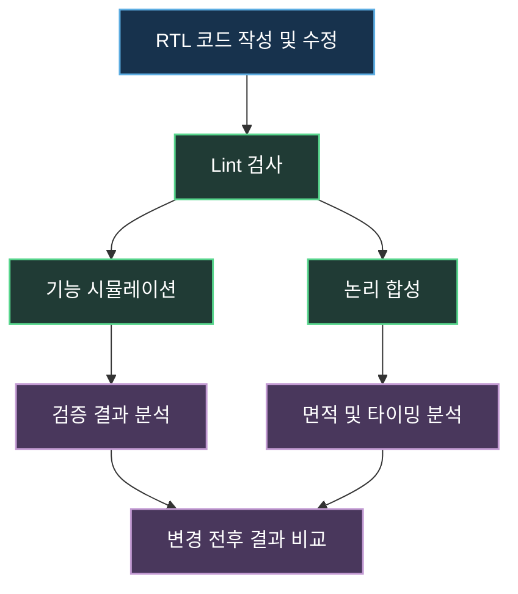

# 디지털 칩 설계 자동화

### RTL Design · Functional Verification · Logic Synthesis

작은 디지털 회로를 직접 설계하고, 검증과 합성 결과를 비교하며
**재현 가능한 설계 자동화 흐름**을 탐구합니다.

 

---

## About This Project

이 저장소는 RTL 설계부터 기능 검증, 논리 합성, 결과 분석까지 이어지는 디지털 칩 설계 과정을 학습하고 기록하기 위한 공간입니다.

RTL 코드를 수정했을 때 회로의 동작과 하드웨어 특성이 어떻게 달라지는지 확인하고, 동일한 조건에서 실험 결과를 비교하는 것을 목표로 합니다.

## Design Automation Flow

| 단계 | 수행 내용 |
|:---|:---|
| **RTL 설계** | Verilog/SystemVerilog로 디지털 회로 작성 |
| **Lint 검사** | 문법 및 잠재적인 설계 오류 확인 |
| **시뮬레이션** | 테스트 입력에 따른 출력과 파형 검증 |
| **논리 합성** | RTL을 논리 게이트 수준의 회로로 변환 |
| **결과 분석** | 셀 면적, 지연 시간, 타이밍 여유 비교 |

## Topics to Explore

### 01. UART Transceiver

- 시작 비트와 정지 비트에 따른 송수신 동작 확인
- Baud rate 설정에 따른 데이터 전송 파형 비교
- 정상 입력과 예외 입력에 대한 검증 시나리오 구성

### 02. Pipelined Multiplier

- 파이프라인 레지스터 추가에 따른 지연 사이클 변화 확인
- 처리량과 전체 지연 시간의 관계 비교
- 임계 경로와 타이밍 특성 분석

### 03. Synthesis Report Analysis

- 동일한 셀 라이브러리와 클록 제약 조건 적용
- 회로 변경 전후의 셀 면적 비교
- 타이밍 리포트를 바탕으로 지연 및 타이밍 여유 확인

> 위 항목은 이 저장소에서 다룰 학습·실험 주제입니다. 각 실험의 진행 상황과 결과는 실제 수행 내용에 맞춰 업데이트합니다.

## Tools & Documentation

| Tool | 활용 목적 | Documentation |
|:---|:---|:---|
| **Verilator** | RTL lint 및 시뮬레이션 | [공식 문서](https://verilator.org/) |
| **Yosys** | 오픈소스 논리 합성 | [공식 문서](https://yosyshq.readthedocs.io/projects/yosys/en/latest/) |
| **OpenROAD Flow** | 디지털 설계 구현 및 분석 흐름 | [사용자 가이드](https://openroad-flow-scripts.readthedocs.io/en/latest/user/UserGuide.html) |
| **Python** | 실험 보조 스크립트 및 결과 정리 | [공식 문서](https://docs.python.org/3/) |
| **GitHub Actions** | 반복 작업 자동화 및 CI 구성 | [공식 문서](https://docs.github.com/en/actions) |

## Experiment Principles

- **조건 통일:** 변경 전후를 비교할 때 테스트 입력과 설계 제약 조건을 동일하게 유지합니다.
- **결과 기록:** 시뮬레이션 파형과 합성 리포트를 함께 보관합니다.
- **재현성 확보:** 사용한 도구 버전과 주요 설정을 기록해 같은 실험을 다시 수행할 수 있도록 합니다.

---

**Design · Verify · Analyze · Improve**

RTL 설계와 검증을 반복하며 디지털 칩 설계 역량을 쌓아갑니다.

